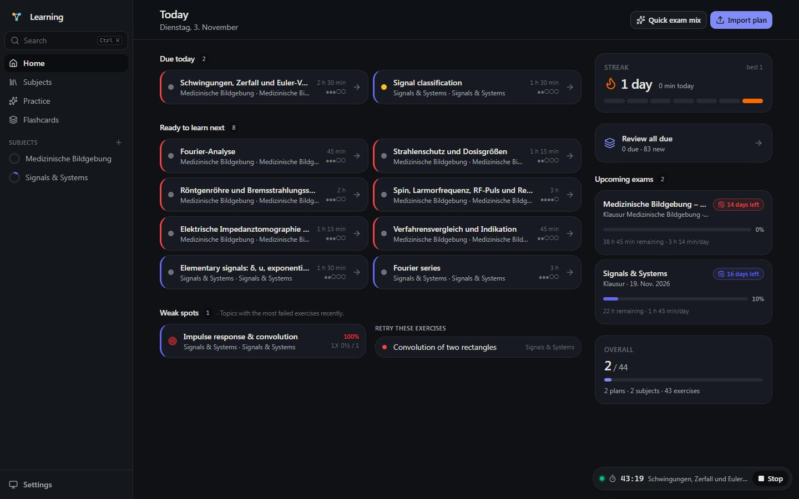
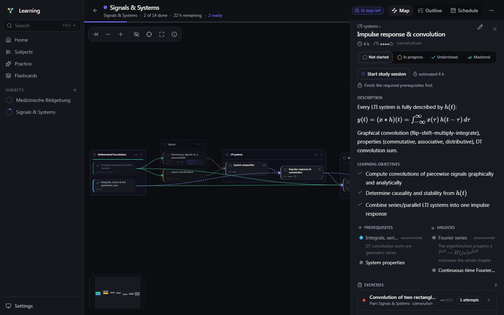
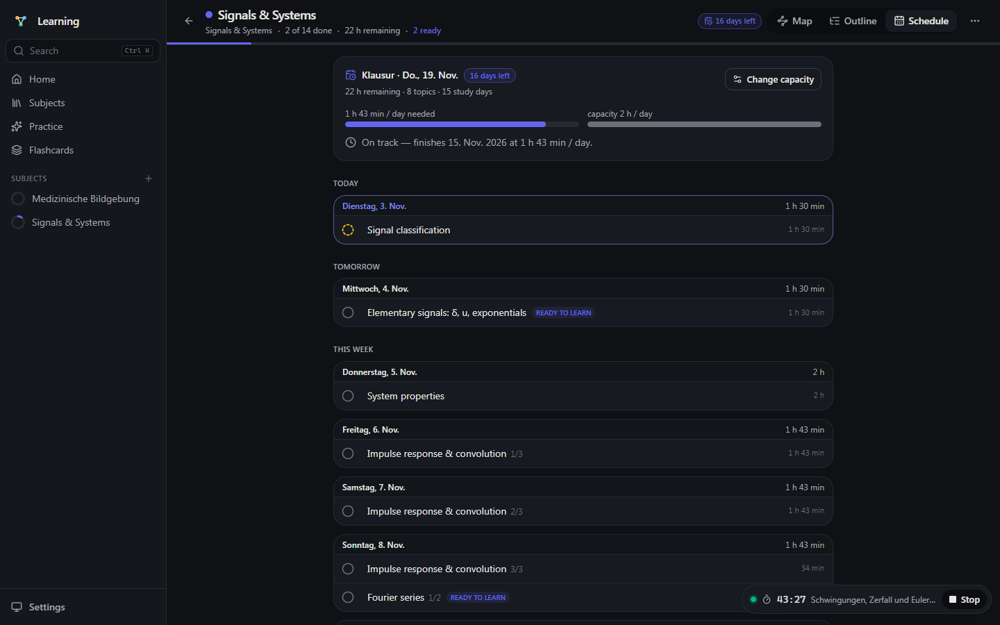
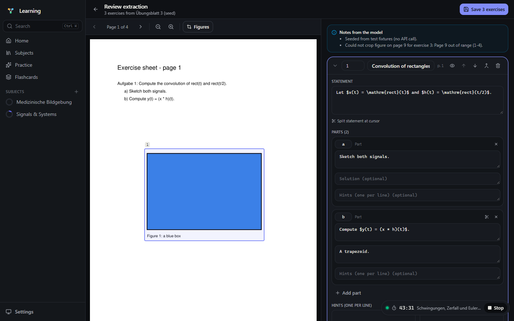
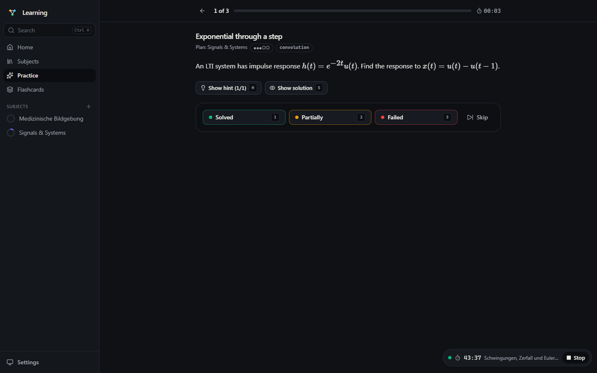
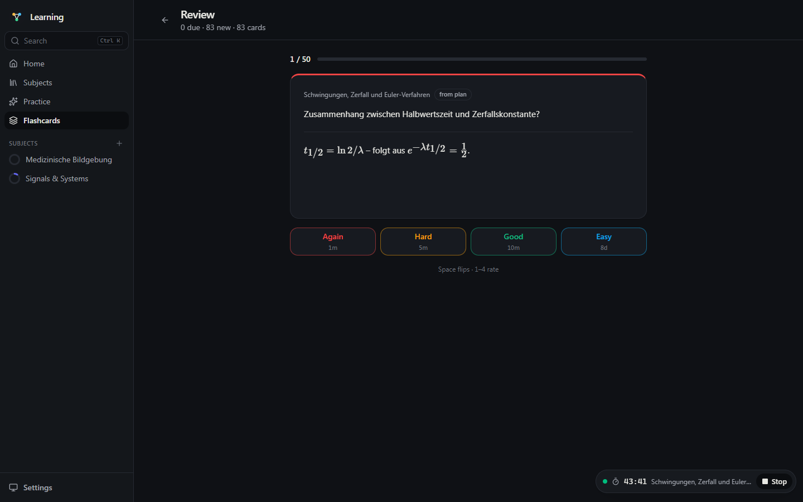
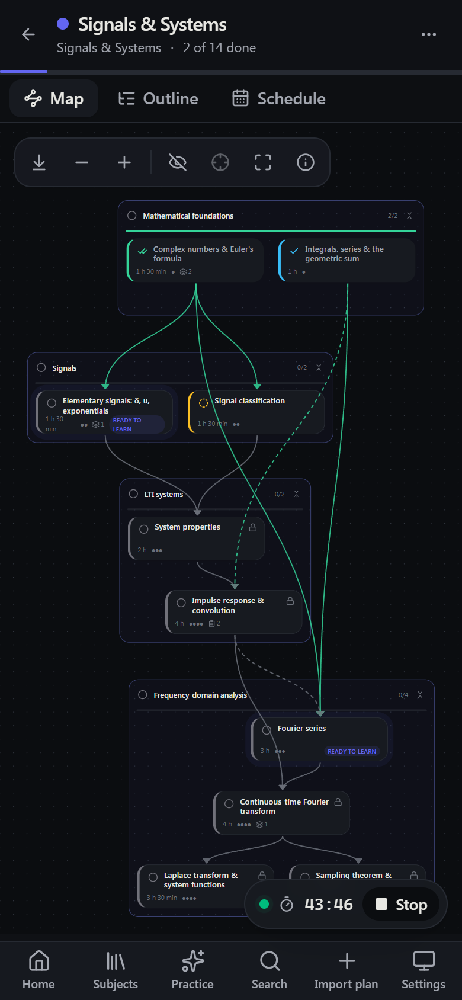
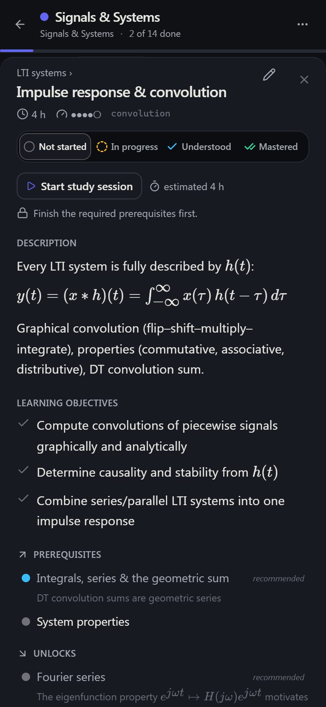

# Drift

A self-hosted, single-user study system for a Medical Engineering degree: structured **learning
plans** as an interactive mind map with prerequisites and progress, **exercise sheets (PDF)** turned
into individual exercises by Claude, an **exam schedule** that re-plans itself, **practice mode**,
**FSRS flashcards**, notes with LaTeX, full-text search — in one Docker container with one data
volume.



## Highlights

| | |
|---|---|
| **Mind map of a plan** — chapters as containers, topics inside, prerequisite edges across them (green = satisfied, dashed = recommended). Glowing cards are *ready to learn*; the side panel shows description, objectives, prerequisites, exercises, flashcards, notes and the study timer. |  |
| **Schedule** — remaining topics spread over the days until the exam, prerequisites first, long topics split across days. Recomputed on every open; warns when the needed pace exceeds your daily capacity. |  |
| **PDF → exercises** — upload a sheet, Claude extracts every exercise with sub-parts, LaTeX, solutions and figure bounding boxes. Review side by side with the original page: edit, merge, split, draw a rectangle to re-crop a figure, confirm suggested topics, save. |  |
| **Practice** — filters by subject/topic/difficulty, random / in-order / weighted *exam mix*; write your answer first (it locks when you reveal the solution, so you compare instead of nodding along); hints and solutions revealed step by step; keyboard-driven; attempts logged with time and your answer. Failed exercises feed the dashboard's weak spots. |  |
| **Flashcards (FSRS)** — cards from plans, your own, or generated from a topic and your notes. Each rating button shows the next interval. |  |
| **Formula sheet per plan** — the formulas you actually need, grouped by topic, added from exercise solutions while you practise (Claude can propose the ones found in a solution; you tick what to keep). Print it or download as Markdown before the exam. | |

<p>
  
  &nbsp;
  
</p>

Works on the phone (outline view by default, map as top-down compound layout, bottom sheets) and
can be installed as a PWA.

## Feature overview

- **Plans**: versioned JSON format ([spec](docs/plan-format.md), [example](docs/examples/signals-and-systems.json)) with hierarchy *and* prerequisite graph, learning objectives, estimates, resources, embedded exercises and flashcards. Import JSON or a Markdown outline; human-readable validation errors with "did you mean"; re-import merges by id and keeps your progress and notes; export with or without progress. A built-in **generation prompt** lets any LLM write a plan in exactly this format.
- **Views**: mind map (React Flow + ELK), outline/checklist, schedule; status per topic (not started → in progress → understood → mastered), minute-weighted progress, "ready to learn" highlighting, focus mode, collapse, hide finished.
- **Exercises**: PDF extraction (text PDFs as documents, scanned PDFs as page images), chunked by page range with stitching, figures cropped at 200 dpi, review screen, manual create/edit, *generate similar exercise*, attempt history with hints → solution reveal.
- **Learning loop**: dashboard (due today, ready, in progress, streak, weak spots, retry list, upcoming exams with pace), study timer with actual-vs-estimated minutes, FTS5 search over everything (LaTeX-aware), command palette (`Ctrl/Cmd+K`) and shortcuts (`?`).
- **Ops**: single Docker image, SQLite + uploads in `/data`, migrations on startup, `/api/health`, password login with secure sessions, in-app backup/restore ZIP, settings page.

## Stack

- **Backend:** Python 3.11+, FastAPI, SQLAlchemy 2, SQLite (FTS5), Alembic, Pydantic v2, PyMuPDF, Anthropic SDK (structured outputs), py-fsrs
- **Frontend:** React 19, TypeScript, Vite, Tailwind v4, Radix, React Flow + ELK, KaTeX, TanStack Query, cmdk
- **Deploy:** multi-stage `Dockerfile`, `docker-compose.yml`, Coolify guide

Docs: [architecture](docs/architecture.md) · [plan format](docs/plan-format.md) · [decisions](docs/decisions.md) · [Coolify setup](docs/coolify-setup.md)

---

## Local development

Prerequisites: Python ≥ 3.11 with [`uv`](https://docs.astral.sh/uv/), Node ≥ 22.

```bash
cp .env.example .env            # set APP_PASSWORD, SECRET_KEY; COOKIE_SECURE=false for http
# backend
cd backend
uv sync                         # creates .venv with all deps
uv run uvicorn app.main:app --reload --port 8000
# frontend (second terminal)
cd frontend
npm install
npm run dev                     # http://localhost:5173, proxies /api to :8000
```

Log in with `APP_PASSWORD`. Import `docs/examples/signals-and-systems.json` to see a full plan.
Try the PDF review screen without an API key: `cd backend && uv run python scripts/seed_review_job.py`.

### Tests & checks

```bash
cd backend && uv run pytest            # 69 tests: schema validation, merge, markdown outline, graph,
                                       # PDF service, extraction parsing/stitching, jobs, schedule,
                                       # search, practice, sessions, flashcards, backup/restore, API
cd backend && uv run ruff check .      # lint
cd frontend && npm run typecheck && npm test && npm run build
```

### Regenerating the typed API client

After changing API schemas:

```bash
cd backend && uv run python scripts/export_openapi.py && cd ../frontend && npm run gen:api
```

### Database migrations

Migrations run automatically on startup. To create one after changing models:

```bash
cd backend && uv run alembic revision --autogenerate -m "describe change"
```

---

## Configuration (environment variables)

| Variable | Required | Default | Purpose |
|---|---|---|---|
| `APP_PASSWORD` | yes | — | Login password |
| `SECRET_KEY` | yes | — | ≥ 16 chars, random |
| `ANTHROPIC_API_KEY` | for AI features | — | Claude API key (PDF import, flashcard / exercise generation) |
| `ANTHROPIC_MODEL` | no | `claude-sonnet-5-5` | Model used for extraction/generation |
| `DATA_DIR` | no | `/data` (Docker) / `./data` | SQLite DB + uploads; mount as a volume |
| `COOKIE_SECURE` | no | `true` | Set `false` only for plain-http local dev |
| `SESSION_TTL_DAYS` | no | `30` | Session lifetime (sliding) |
| `MAX_UPLOAD_MB` | no | `50` | PDF upload limit |
| `EXTRACT_CHUNK_PAGES` | no | `8` | Pages per Claude request when extracting exercises |
| `LOG_LEVEL` | no | `info` | |

---

## Deploying on Coolify

A detailed, hand-off-ready guide (also suitable for an AI assistant) is in
[`docs/coolify-setup.md`](docs/coolify-setup.md). Short version:

1. **New Resource → Private Repository**, build pack **Dockerfile**, port `8000`, your `https://` domain.
2. **Environment variables**: `APP_PASSWORD`, `SECRET_KEY`, `ANTHROPIC_API_KEY`, `ANTHROPIC_MODEL=claude-sonnet-5-5`, `DATA_DIR=/data`.
3. **Storages → Volume Mount → destination `/data`** (without it, a redeploy wipes your data).
4. Deploy. Migrations run on start; log in with `APP_PASSWORD`. Enable *Auto Deploy* for push-to-deploy.

### Backup

Everything lives in the `/data` volume: `app.db` (SQLite) and `uploads/`. *Settings → Download
backup* gives you a consistent ZIP of both; *Restore* re-imports it (the previous database is kept
as `app.db.bak-…`). Copying the volume directory is a valid backup too.

### Run with docker compose (local or on any VPS)

```bash
cp .env.example .env && $EDITOR .env
docker compose up -d --build
# http://localhost:8000
```

---

## Using it

1. Create a subject (or let the import create one).
2. Click **Generation prompt**, fill in topic/context/exam date, copy, paste into an LLM, paste the
   returned JSON into **Import plan**. Problems are explained line by line; warnings are auto-fixed.
3. Work in the **Map** (desktop) or **Outline** (phone): click a topic for details, notes and
   exercises; click the status circle to tick progress. Glowing cards are *ready to learn*.
4. When the LLM revises the plan, import it again: content updates, progress and notes stay.
5. **Export** a plan (with or without your progress) from the plan menu.
6. **PDF exercise sheets:** subject page → *Upload PDF* → *Extract exercises* → **Review** (edit,
   merge/split, re-crop figures, confirm topics) → **Save**. Scanned PDFs are handled automatically.
7. **Schedule:** set an exam date; the *Schedule* tab plans your days and re-plans when you fall behind.
8. **Practice:** *Practice* in the sidebar, the exam-mix button on the dashboard, or "Practice this
   topic" in a node panel. Keyboard: `H` hint, `S` solution, `1 / 2 / 3` log, `N` next.
9. **Study timer:** *Start study session* in a node panel; the pill shows the running time; sessions,
   attempts, status changes and notes count towards the streak.
10. **Search & shortcuts:** `Ctrl/Cmd+K` (or `/`) opens the command palette; `?` lists all shortcuts.
11. **Flashcards:** *Flashcards* in the sidebar reviews everything due; `Space` flips, `1–4` rates.
    Add your own cards or *Generate cards* from a topic in the node panel.
12. **Similar exercise:** exercise menu → *Generate similar exercise* for variation practice.
13. **Backup & restore / install as app:** *Settings*.

## Roadmap

- **Phase 1 (done):** subjects, plan import/validation/merge/export, mind map, outline, progress, notes, Docker/Coolify.
- **Phase 2 (done):** PDF exercise import (Claude extraction with strict schema, chunking, figure cropping, scanned fallback, review screen, exercise editing).
- **Phase 3 (done):** practice mode with exam mix, schedule view with live recalculation, dashboard with due-today/streak/weak spots, FTS5 search, command palette + shortcuts, study timer.
- **Phase 4 (done):** FSRS flashcards with Claude generation, similar-exercise generation, backup/restore ZIP, settings page, PWA install.
- **Ideas next:** FSRS parameter optimisation from review history, notes on attempts in practice mode, weekly review summary, sharing plans with friends (the data model is already per-user).

## License

MIT — see [LICENSE](LICENSE).
